# Ableton Tutorial 1

Ableton Live Reference Manual:
<https://www.ableton.com/en/live-manual/12/welcome-to-live/#welcome-to-live>

## Initial Setup

Once you've opened Ableton Live 12, set up the audio output.

Go to Live's settings, then to the `Audio` tab.

Configure `Audio Output Device` to the audio output you want to use.

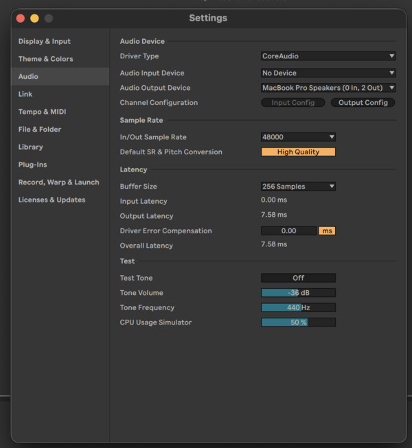

Now go to the `Record, Warp, & Launch` tab.

- Loop/Warp Short Samples: Unwarped One Shot
- Auto-Warp Long Samples: Off

These settings tell Live not to try to detect the tempo/BPM of the samples we load in. These default settings might be good if we were making house music...

Close the settings window.

## Create a new file

Go to File > New Live Set to start with a fresh default session.

## Views Ableton Live has two views: `Arrangement View` and `Session View`. You

Use the `TAB` key to switch between them.

`Arrangement View` looks like a conventional timeline: something you'd expect
to see in video editing software. You can arrange clips of audio or MIDI (we'll
talk about MIDI later) on the timeline and play them back.

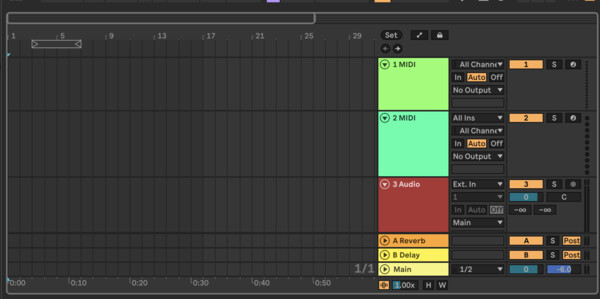

`Session View` has a grid at the top, with a mixing console below it at the
bottom. The Session View grid can hold audio and MIDI clips, too. But rather
laying the clips out on a timeline, the grid lets you play the clips in
whatever order you want.

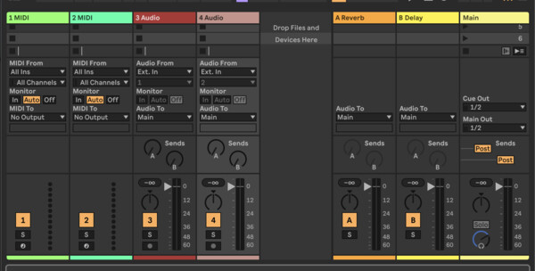

We'll spend most of our time in `Arrangement View`.

## Tracks

In the default, empty Live set, Ableton shows you 7 tracks:

- 2 MIDI Tracks
- 2 Audio Tracks
- 2 Return Tracks
- 1 Main Track

For now, we will just focus on the Audio Tracks and the Main Track. You can
delete the others by clicking the track heading and pressing the backspace key.

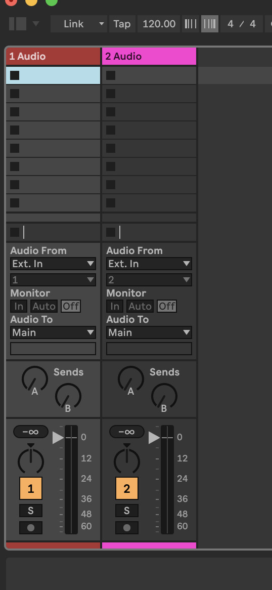

Now, you're left with 2 audio tracks. If you're currently in the session view,
go to the arrangement view by pressing `TAB`.

> [!TIP] The session and arrangement views share the same tracks.

> [!TIP] You can create a new track by going to Create > Insert Audio Track

## File browser

Download the sound files you want to use for this project and save them to
folder somewhere on the computer.

On the upper-left hand corner of the window, there is a button that shows/hides
the File Browser. Show the browser.

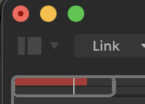

Now, go to `File > Add Folder to Browser...` and select the folder containing
your sound files.

You should now see this folder in the browser (towards the bottom)

Clicking the folder shows its contents in the browser. Clicking a sound file in
the browser allows you to audition it. (If it doesn't play, you might need to
click the little button with the headphones on it next to the waveform.)

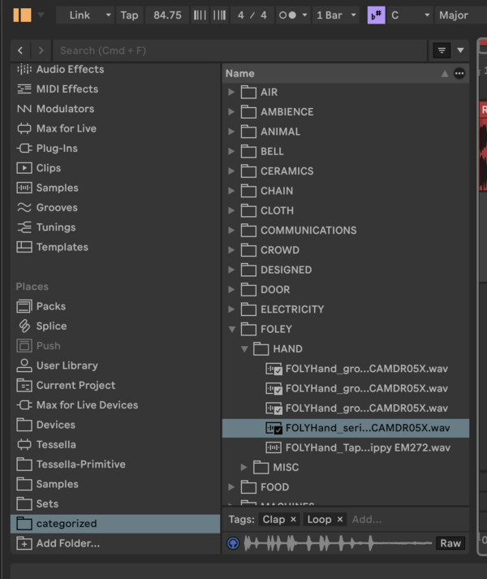

## Creating your first arrangement

Pick a sound you like, and drag it into the arrangement.

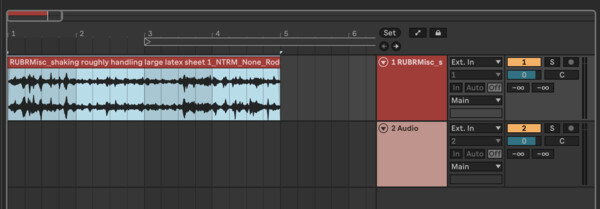

You can zoom in and out on the timeline by hovering your cursor on the top of
the timeline (where the numbers are). You cursor will turn into a magnifying
glass. Then, click and drag.

To play, either click the play icon at the top of the window, or hit the space
bar.

You can play from a particular position on the timeline by putting your cursor
in the region between the numbers at the top of the timeline and the top of the
first track. Your cursor will switch to a speaker icon.

Now, add a second sound to the other track. If you want, you can make it
overlap with the sound in the first track.

Let's make this region loop so that we can let it play continuously. Select a
region by clicking and dragging along the timeline. Then, press `CMD/CTRL + L`
or click the loop button in the transport bar at the top of the screen.

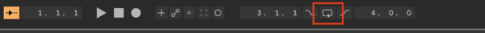

Now, if you press play, you'll loop this region.

## Mixing

Now, let's adjust the volume and panning of the sounds on each track.

Live, like most DAWs, is structured in a way that borrows from a traditional
mixing desk. Each track goes through an audio processing chain that allows you
to transform the sound of the audio flowing through the track. At the end of
the chain are some basic controls for controlling the `volume` and `panning`
(left/right stereo mix) of the sound.

There are many ways to interact with the mixer in Live.

- In Arrangement View, a minimal form of the mixer is shown on the far right
  hand side.
- Show a full mixer in Arrangement View by clicking the button in the
  bottom-right corner of the window
- Session View by default shows a full mixer

Let's enable the full mixer in arrangement view by clicking the button in the
bottom-right corner.

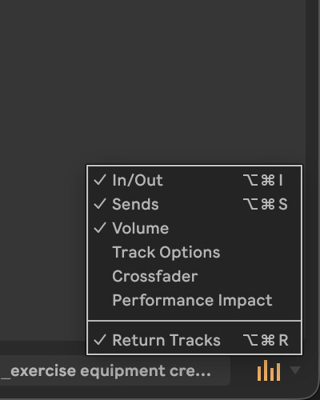

Experiment with the gain fader (volume control) and panning dial to see what
happens.

The audio on all of your tracks will be mixed together and sent to the `Main`
track on the far right. This is the output that goes to your headphones or
speakers.

## Fading Audio Clips

We can create fade-ins and outs of the audio clips by clicking and dragging on
the little handles in the upper-right hand corner of the audio clips.

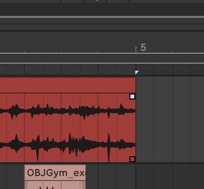
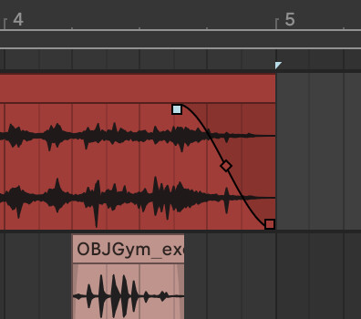

Experiment with this to bring sounds in and out of the mix.

## Automation

We can also **automate** the movement of the mixer controls.

Let's start by automating the panning.

Right-click on one of the panning dials and select "Show Automation in New
Lane".

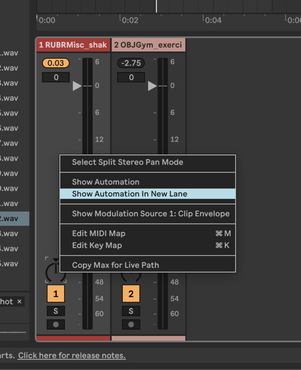

This creates a new "lane" under the track with a red dotted line in it. The
line being dotted tells us that there is no automation on the panning
parameter.

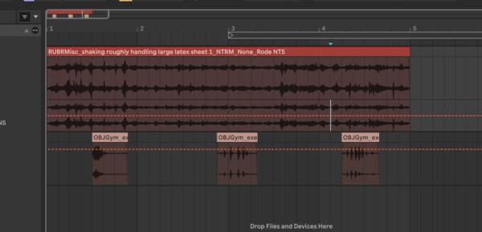

Click on the red line to create automation breakpoints. Now, the line is solid,
telling us that we are automating this parameter.

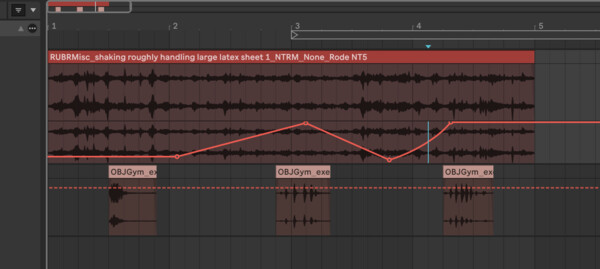

The dial also has a red dot on it, telling us that this is an automated
parameter.

Play the audio now to see what happens.

Almost any parameter in Live can be automated! You can even record automations,
but we'll talk about this another time.

> [!TIP] If you edit a parameter that has automation, it will disable the
> automation. You'll see that the automation lines are gray. Re-enable all
> automation, click the icon with the leftward-pointing arrow on it. It will be
> orange when the session includes disabled automation.

> [!TIP] You can toggle the visibility of all automations using the `a` key on
> your keyboard or this tiny button:
> 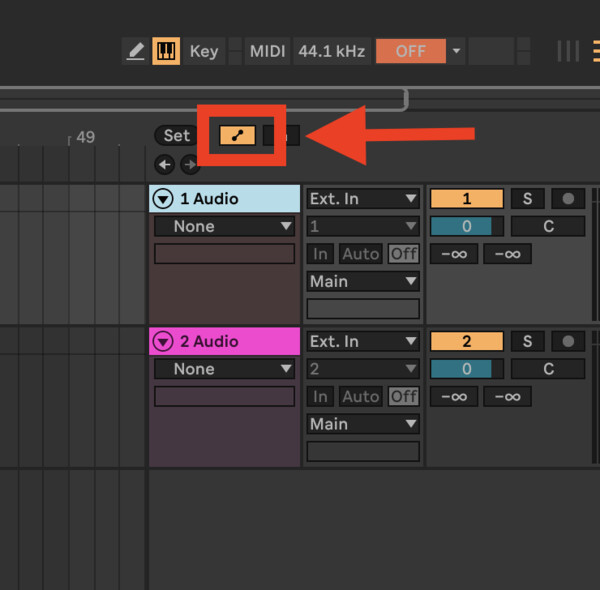

## Practice

See what you can create by adding more tracks, more sounds, and more mixing
adjustments and automations.

## Saving your work

> [!IMPORTANT]
> If you don't follow these steps for saving, you're going to be sad in the
> future.

Since we are using audio files from our library in the session, we need to make
sure that these files remain linked to the session. There are two ways to do
this:

- Make sure that the audio files stay in the same place relative to the session
  (not recommended on a shared computer like the one in the studio!!)
- Save the files directly to the Ableton project (recommended!)

Go to `File > Collect All and Save`. In the dialog that pops up, select `Yes`
for all of the categories. Then save to whatever location you like. This
creates a folder that contains:

- The Ableton Live Set (`.als`)
- Your samples and other media

Next time you want to open this project, open the `.als` file. As long as you
used Collect All and Save, everything should work. If you failed to use Collect
All and Save, you could end up with some missing files.

> [!IMPORTANT]
> Always use Collect All and Save to save your project when working on a shared computer
