# Ableton Tutorial 2

## Prerequisites

Make sure you've followed the steps documented in [Tutorial 1](/resources/ableton-tutorial-1). You should have:

- Set up your audio settings in Live's preferences
- Added clips to your timeline in arrangement view

This tutorial expects that you learned the following skills in Tutorial 1:

- Configure audio I/O settings in Live
- Add a folder to Live's File Browser
- Switch between Session and Arrangement Views
- Add and adjust clips on the Arrangement View timeline
- Zoom and navigate the Arrangement View timeline
- Show the mixer in Arrangement view
- Making adjustments to track volume and panning using the mixer controls
- Automate mixing parameters using Live's automation mode
- Toggle the visibility of automation on and off
- Override automations and re-enable them.

## Live's Info View

Before we dive in, let me show you one useful tool that will help you navigate and learn live: the Info View.

Info View is a pane in the lower-right hand corner that shows information about
any control that you hover over in Live. Display it by clicking the "i" icon in
the lower left hand corner of Live's Window.

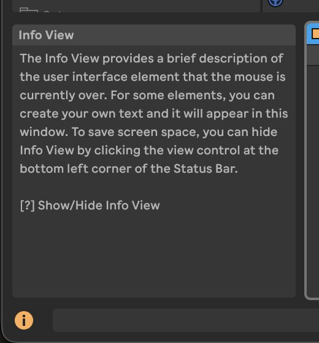

## Adjusting audio clips

In Tutorial 1, we learned how to adjust the track gain and panning using the
mixer controls. You also learned to click and drag clips on the timeline. These
changes affect the track that the audio is flowing through. However, you can
also directly transform the audio clips themselves. These transformations
include:

- Increasing or decreasing the gain _of the audio clip itself_
- Changing the pitch of the audio clip
- Changing the start and end points of the clip
- Other adjustments such as warping or reversing the clip

To make these adjustments, we will need to open the Clip View. The easiest way
to do this is to double-click the colored title bar of an audio clip. You can
also show the Clip View by clicking on the clip, then clicking the Clip View
toggle button at the bottom of the window:

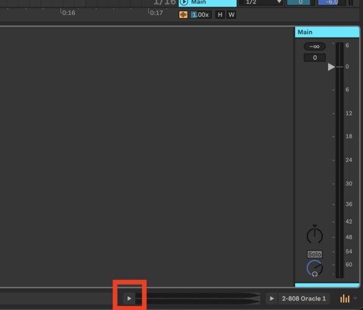

The Clip View looks like this:

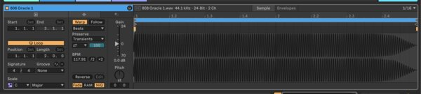

To the direct left of the clip waveform, you should see controls for gain and
pitch. If you don't see them, make sure you have the correct tab selected:

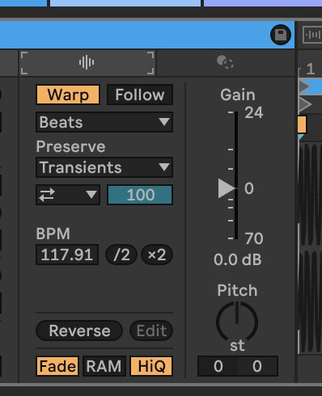

### Clip Gain and Pitch Adjustment

You'll notice that as you adjust the gain, it scales the waveform view. This
gain control is separate from the volume fader on the track.

You can also adjust the pitch of the clip. How exactly this pitch control works
depends on the `Warp` settings to the left. As with many things, the best way
to understand it is to just play with it, here's a short explanation.

- As we have seen in the past, if we speed up or slow down an audio clip, we
  change _both_ its timing and its pitch.
- If we want to change _only_ the pitch and _not_ the timing, or vice versa we
  need a special algorithm
- Live has several of these algorithms built-in.
  - If `Warp` is disabled, the Pitch dial will behave like a tape machine,
    adjusting _both_ the pitch and timing
  - Enabling `Warp` will allow you to use pitch/time shifting algorithms menu
    below the `Warp` button to select different `Warp Modes`. These warp modes
    represent different ways that Live can analyze the audio clip and will cause
    it to use different algorithms for pitch/time shifting.

Which `Warp Mode` you use depends upon the nature of your audio clip. It might
be different for different types of audio. Experiment with it until you are
happy with the results!

### Clip Start and End Time Adjustment

You can also change where the clip starts and ends from the `Clip View`.

As you already know, you can adjust the length and position of a clip on the
`Arrangement View` timeline, but what if you wanted to keep the clip in the
same spot on the timeline, but change which _part_ of the clip was playing?
This can be achieved by changing the start and end times in of the clip in the
`Clip View`.

To do so, find the triangular markers above the waveform in the `Clip View`
area. There will be two sets of triangular markers. The start and end markers
are the lower ones.

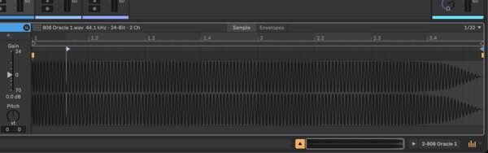

## Track Effects

As we've seen, the `Clip View` allows you to see the details of a clip on a
track. Tracks also are able to load a series of a devices that process the
sound of the audio flowing through the track.

A (simplified) diagram of the track's signal flow is:

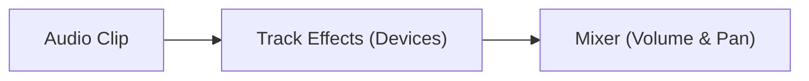

Devices are visible in the `Device View`. Display it by clicking the `Device
View Toggle` at the bottom of the window (to the right of the `Clip View
Toggle`).

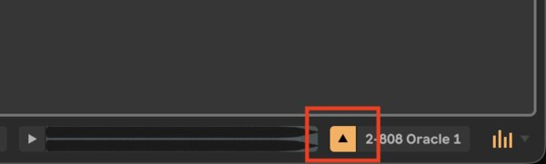

This will show a blank pane:

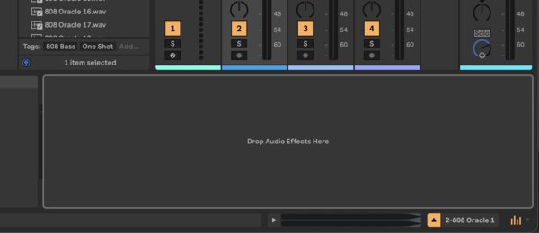

Now we'll add devices to the track. Open the Browser and go to the Audio
Effects tab.

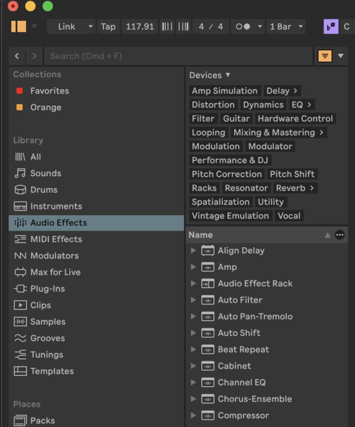

Here, you will see a long list of audio effects, each of which is able to
process the audio in a unique way. Expanding an effect reveals a list of
presets for that effect.

Find `EQ Eight`, expand it, and select a preset, such as `Piano EQ 1`. Drag the
preset into the `Device View` area.

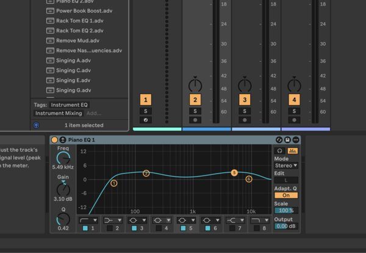

Now, start playback. If necessary, solo the track so that you can focus on it.
You can compare the sound of the audio with and without the effect by clicking
the round yellow button in the upper left hand corner of the device.

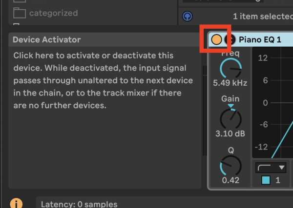

`EQ Eight` is an equalizer, which is a device that allows you to turn up or
down the volume of sections of the frequency spectrum.

You can click and drag on the numbered markers inside the `EQ Eight` device to
adjust the frequency and gain of the filters in the equalizer. The drop-down
menus along the bottom change the filter type. Experiment with these to get a
feel for how they affect the sound.

You can add as many effects as you want to your track. One helpful way to
explore the effects is use the filter categories shown above the list of audio
effects in the browser:

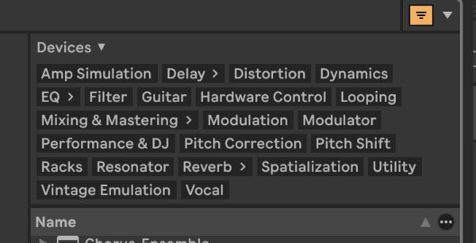

These are some common categories and what they are:

| Category   | Description                                                                                                    | Recommended Devices                                                                  |
| ---------- | -------------------------------------------------------------------------------------------------------------- | ------------------------------------------------------------------------------------ |
| Delay      | Echo effects                                                                                                   | Echo, Filter Delay, Delay, Grain Delay                                               |
| Distortion | Adds thickness, roughness, or intensity to the sound.                                                          | Saturator, Erosion, Roar, Redux                                                      |
| Dynamics   | Adjust the loudness and the variation in loudness of the signal                                                | Compressor, Glue Compressor, Limiter                                                 |
| EQ         | Increase or decrease the gain of sections of the frequency spectrum.                                           | EQ Eight                                                                             |
| Filter     | Very similar to EQ, sometimes includes forms of distortion.                                                    | Auto Filter                                                                          |
| Modulation | Kind of a mixed bag of effects that change the tone, charater, or pitch                                        | Auto Pan-Tremolo, Chorus-Ensemble, Phaser-Flanger, Spectral Resonator, Spectral Time |
| Resonator  | An extreme form of filter/EQ that causes particular frequencies to ring. Works best with a noisy input signal. | Corpus, Resonators                                                                   |
| Reverb     | Emulates sound reverberating within a space (the sound bouncing off the walls of the space)                    | Hybrid Reverb                                                                        |

### Learning Effects

As you can see, there are many audio effects that do many different things.
Some tips for learning them:

1. Use the presets. The presets can help you quickly get a feel for what the
   effect is able to do. A preset can often also be a good starting point.
2. Use the `Info View`. Open the `Info View` and hover over the parameters of
   the device to learn about what they do.
3. Tinker and play. These effects work in real time, so you can just create a
   loop on the timeline and tweak the settings on the device to see what they
   do.

> [!TIP] Many effects will have a parameter called `Dry/Wet`. This mixes from
> the unaffected input signal ("dry") to the affected signal ("wet").
