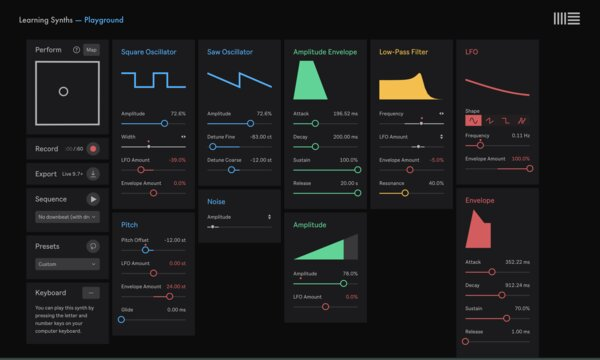
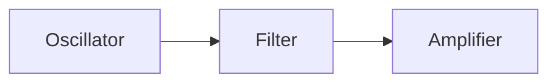

# Ableton Tutorial 3

## Learning Synths

This lesson will be spent outside of Ableton Live. We'll use a website created
by Ableton called [Learning Synths](https://learningsynths.ableton.com/)

Walk through tutorial by clicking the `Next` button. It will teach you a series
of basic synthesizer concepts.

At the end of the tutorial, you'll arrive at the playground, which is a
complete synthesizer running in your browser:

You can also any of the examples from the tutorial in the playground to use
them as a starting point for your own experiments.

## Key Concepts

This style of synthesis is called _subtractive synthesis_ it's the most
classic, common style of synthesis. There are many other types, too. What all
types have in common is that we can model them using a _signal chain_, which is
a series of audio-processing stages.

For the subtractive model that we have been exploring in Learning Synths, the
signal chain looks like this:

The oscillator is the initial sound source. In the subtractive synthesis model,
this initial sound source is a constant, harmonically-rich tone.
"Harmonically-rich" means that there is content across the frequency spectrum.
In Learning Synths, there are three oscillators (square, saw, and noise) that
are added together. Next, the filter is used to sculpt away some of the
harmonics. The role of the filter in "subtracting" harmonic material from the
sound is why we call it "subtractive synthesis". Finally, the amplifier just
controls the volume of the output.

Each of these components has _parameters_. For example, the oscillators all
have a frequency parameter that might typically control using an interface like
a piano keyboard. The filter's typical parameters are the _cutoff frequency_
and the _resonance_, and we often control these parameters with a knob or
slider.

The amplifier has just one parameter - the level - which is typically
controlled by an ADSR (attack, decay, sustain, release) envelope generator that
is triggered by presses of the synth's keyboard. The envelope generator
generates a _control signal_ that is able to _modulate_ the parameters of the
core audio-processing components. An LFO (low-frequency oscillator) is another
type of control signal generator. Technically, LFOs are nearly identical to the
audio oscillator in the main signal chain, but they just oscillate more slowly.

A control signal can be used to modulate many parameters of a synth. These
"invisible hands" that modulate the parameters of the instrument allow us to
transform the timbral character of the instrument over time.

## Glossary of Synth Terms

- **Signal**: A stream of audio. In the **acoustic** domain, this is a pressure
  wave that travels through the air. In the **analog** domain, it is an
  electrical current. In the **digital** domain, it is a stream of numbers
  flowing at the computer's sample rate.
- **Amplitude**: The volume of a signal. When looking at a waveform, it is the
  "height" along the vertical axis.
- **Amplifier**: An audio-processing component that multiplies the signal,
  changing its altitude.
- **Envelope**: A function that describes the change in some value (such as the
  amplitude) over time.
- **Envelope Generator**: An audio component that produces an envelope for use
  as a control signal. When an envelope generator is triggered (e.g. through a
  keyboard press), it "plays back" the envelope.
- **Oscillator**: An audio component that produces a periodic (repeating) wave.
  Oscillators are a fundamental building block of synthesizers, because they
  produce an initial tone that is sculpted by other components like filters and
  amplifiers. Oscillators can produce waves of many shapes. The three classic
  shapes are **sine**, **square**, and **saw**.
- **LFO**: An oscillator whose frequency is below 20Hz, making it suitable for
  use as a control signal.
- **Control Signal**: A signal whose job is to control or "modulate" some
  parameter of the synth. Synths have many parameters: the pitch of the
  oscillators, the cutoff frequency of a filter, and the rate of an LFO are all
  parameters are commonly modulated by control signals.
- **Filter**: An audio processing component that shapes the frequency spectrum
  of the sound by turning up or down the amplitude at particular ranges of
  frequencies. There are many types of filters. The most common are _low pass
  filters_, which reduce the amplitude of frequencies above some point, which is
  known as the _cutoff frequency_.
- **Equalizer (or EQ)**: An audio component that consists of a bank of filters.
  Allows you to fine tune the tone of a sound by shaping its frequency spectrum.
