# Ableton Tutorial 4 - MIDI and Synths in Live

## About MIDI

MIDI (Musical Instrument Digital Interface) is a protocol for communication in electronic music systems. MIDI defines a set of message types that we can use to send commands to synths and other devices used in electronic music. There are many types of MIDI messages, but for now we'll only worry about one type:

- **Note** Messages: Messages that tell the synth to start and stop playing a note or sound event.

> [!BTW] Other message types
> There are MIDI messages for other things like remotely controlling the parameters of the synth and loading presets. Hardware synths, drum machines, and other devices also receive MIDI clock messages to synchronize with the timing of other devices.

> [!INFO] Message format
> MIDI is an old protocol (from the 80s), so all messages consist purely of 7-bit integers (integers on the range of 0 to 127).

### Note Messages

There are two types of note messages: `note on` and `note off`

- A **note on** message is sent when the note begins (e.g. when the key on the keyboard is pressed)
- A **note off** message is sent when the note ends (e.g. when the key on the keyboard is released)

A note message contains two pieces of information:

- a **pitch** on the range of 0 - 127 (C-2 to G8).
- a _velocity_, also 0 - 127. You can consider velocity to be how hard the key was struck. Note off messages always have a velocity of 0.

Therefore, a common MIDI note on message would look like this:

```txt
60 90
```

This specifies a note on message with a pitch of 60 (C3) and a velocity of 90.

Some time later, we'd expect to see a note off message, which looks like this:

```txt
60 0
```

The velocity of 0 indicates that this is an note-off message, and the pitch of 60 tells the synth that it should interrupt the C3 note it is currently playing.

## MIDI in Ableton Live

Let's get MIDI set up in Live to test this out.

Start by enabling Computer MIDI Keyboard mode by lighting the button in the upper-right corner of Live that has a piano keyboard on it:


Next, in the menu bar, go to `Create > Insert MIDI Track...`

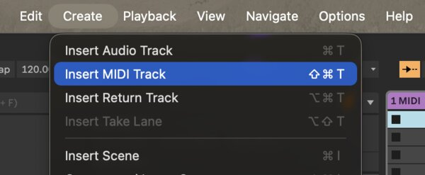

This will create a new track that looks similar to the audio tracks we have used so far, but the mixer looks different. In place of the level meter and gain fader, this is a column of circles.
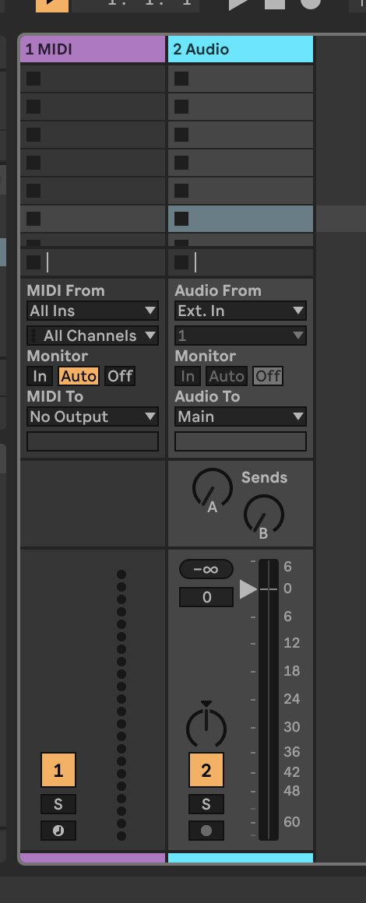

If you don't see the I/O section with the menu labeled `MIDI From` like in the image above, click the small triangle in the lower-right corner of the window and enable `In/Out`.

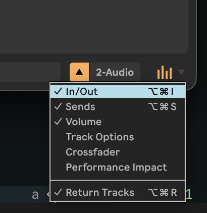

Now, in the I/O section on the MIDI track, make sure **Monitor** is set to `Auto`.

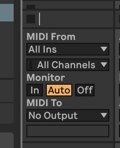

Finally, go to the bottom of the MIDI track and click the bottom button with a small circle on it. It will light red when it is activated.

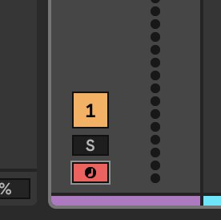

Now we are ready to test the MIDI. Press any key on the middle row of the keyboard (`f`, for example). You should see the circles on the MIDI track light up. This tells us MIDI is flowing.

To get a better idea about the exact content of the MIDI messages we are sending, we can add a `MIDI Monitor` device to the track.

Open the browser and go to the `MIDI Effects` tab. Find `MIDI Monitor` and drag it onto the MIDI track.k

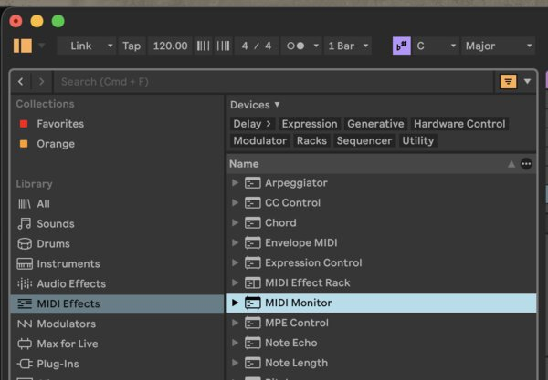

Open the `Device View` for the MIDI track (see [tutorial 2](/ableton-tutorial-2) to learn about this). You should see the MIDI Monitor device, which has a display showing a keyboard.

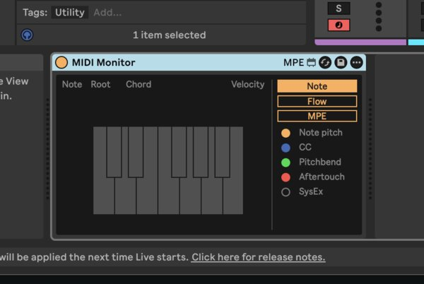

Now, press and hold a key on the keyboard. The MIDI monitor will tell you which note and velocity you're playing.

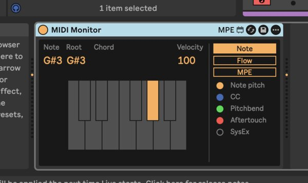

### One last thing - recording and looping MIDI

Before we get to the fun part, let's do one last thing that will benefit us in the future.

If you're not already looking at Live's `Arrangement View`, switch to it by pressing the `Tab` key. Then, click the circular record button next to the play button near the top of Live's window. The timeline should start playing automatically (if it doesn't, press the triangular play button). The MIDI track will be shaded red.

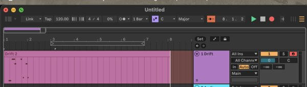

Now, play some notes. These will be recorded to the timeline. Play as many notes as you want, then hit the stop button (square) to stop playback.

You just recorded a new MIDI clip on to the timeline. Now, let's loop it. Click to select the clip, then press `Ctrl + L` (`CMD + L` on Mac). This will enable looping and place the loop markers at either end of the new click. Adjust the loop markers if you like.

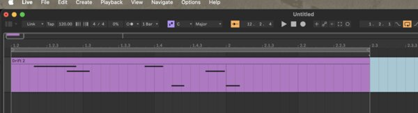

Now, click the clip again and hit play (or press `Spacebar`). This will loop the MIDI clip, causing a consistent stream of MIDI messages to flow through the MIDI track.

## Adding a Synth

Now that MIDI is set up, we are ready to add a synth to the MIDI track. Go back to the browser, this time to the `Instruments` tab. Select `Drift` and drag it onto the MIDI track.

> [!TIP] BTW
> As we learned in tutorial 2, all devices in Live have presets. Feel free to explore these in the future, but for now, we'll just use it in its default state.

Press some keys to play the synth (or start transport to play your looping MIDI clip). You will hear a bright, plucky synth sound.

`Drift` is a synth very similar to the one we learned about in [tutorial 3](/ableton-tutorial-3) on the Learning Synths website. It has two oscillators, a noise generator, a filter, and two envelope generators. By default, the first envelope generator is routed to the amplitude, and the second EG is routed to the filter cutoff. Let's go through the stages step by step:

### Oscillators

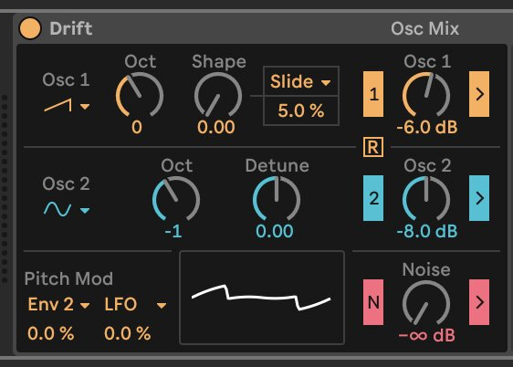

There are two oscillators on `Drift` that will be added together. You can change the oscillator wave shape and tuning of each oscillator. You can also turn on or off each of the oscillators. The waveform viewer at the bottom shows you what the combined waveform will look like. Play with these settings to see how they transform the sound.

> [!TIP]
> You just changed some settings of the oscillator, which may cause the next sections of this tutorial to sound different from how I expect them to sound for you. If you're confused at any point, try reverting Drift to its default settings by just clicking and dragging a fresh instance of Drift from the browser onto the MIDI track.

### Filter

Moving rightward across the device, we encounter the filter section next.

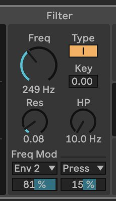

Drift actually gives us two filters in series, a high pass and a low pass. The main `Freq` knob controls the cutoff frequency of the low pass filter. The `HP` knob controls the cutoff frequency of the high pass filter. Play with these to see how they affect the sound! As you turn the `Freq` knob to the left, you will hear the higher frequencies be sculpted away, resulting in a more dull sound. As you turn the `HP` knob to the right, you'll hear the low frequencies attenuated, rendering a "thinner" sound.

To the right of the device is a display showing the frequency response of the filter.

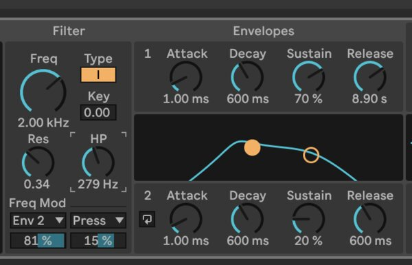

> [!TIP] Tip
> The display is multi-purpose. When you edit a filter parameter, it shows the filter response. When we start editing the envelopes in a moment, it is used to display the envelope's shape.

`Drift`'s default preset maps an envelope to the low pass filter's cutoff frequency. In the section labeled `Freq Mod`, `Env 2` is selected in a drop down menu, indicating that Envelope 2 is being used to modulate the cutoff frequency of the filter. The number box below the drop down menu sets the `modulation amount`: the amount of an effect that envelope 2 will have on the cutoff frequency.

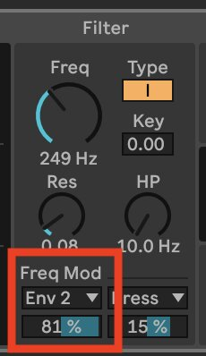

Try playing with this `modulation amount` parameter to see how it changes the sound. In the default state, `Drift` is very bright at the beginning, then becomes more dull over the course of the note. If you set the modulation amount to 0%, you'll hear how much brighter it is for the duration of the note.

### Envelopes

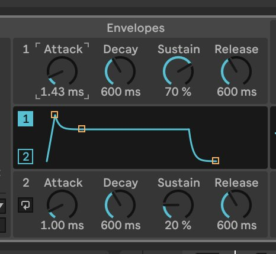

Moving right a bit further, we reach the envelopes. As noted, the first (upper) envelope is automatically routed to the amplifier. We learned about amplitude envelopes in depth in tutorial 3. If you need a refresher, go read it!

Try changing the `Release` parameter of the upper envelope. You'll notice that this causes the notes to become longer. This is because `Release` controls the amount of time that it takes for the envelope to fall back to 0 after the synth receives the MIDI note off message.

Now, try changing the other parameters of the upper envelope and observe how they affect the change in amplitude of signal over time. Do the same for the lower envelope and hear its effect on the low-pass filter.

### Modulation Routing

While the envelopes control the amplitude and the filter by default, there are other ways that we can use them. Click the `Mod` tab to review the modulation routing section of the synth.

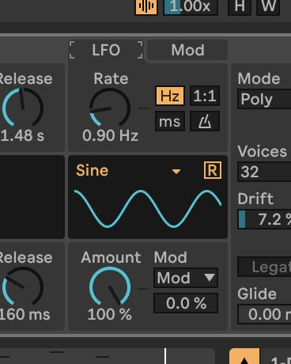

These allow us to set up custom routings of modulation sources like the envelopes or LFO to parameters of the synth. Let's try one.

In any of the modulation slots, set the `modulation source` (upper menu) to `Env 2 / Cyc`. This is envelope 2. Set the `destination` (lower menu) to `Osc 1 Shape`, and set the depth (middle number box) to `80%`.

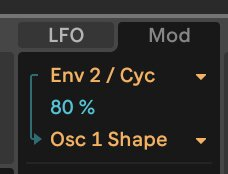

Now send notes to the synth.

We're now using envelope 2 to control the `Shape` parameter of oscillator 1. You are likely to hear a pretty crazy lazer zap sound. Looking at the waveform view to the lower left of the device, you can see the waveform changing in response to the modulations.

### LFO

Let's try one more modulation, this time with the LFO.

In another modulation slot, use these settings:

- `Source`: `LFO`
- `Amount`: `36%` (ish)
- `Destination`: `LP Frequency`

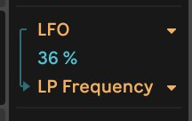

Now, switch to the LFO tab, and set the `Rate` to about `20 Hz`.

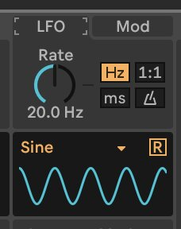

Now play the synth and you'll hear the low pass filter fluttering in response to the 20 Hz LFO.

> [!TIP] Note
> Earlier in the tutorial, envelope 2 was modulating the same parameter as our LFO (the low pass filter cutoff frequency). Assuming you still have non-zero depth in the `Freq Mod` section of the `Filter`, then you now how have _both_ envelope 2 and the LFO modulating the cutoff frequency. These interactions between multiple modulation sources can lead in very interesting and surprising places. They can also cause you to hear no sound at all, such as if their combination causes the cutoff frequency to be set so low that the sound is inaudible. If you're stuck, try starting over: just grab a fresh instance of Drift from the browser and drag it on to the track.

## Going Further

That's it for this tutorial. As you can see, there are a bunch of parameters in Drift we didn't talk about. There are also many other synths in Live! Feel free to explore, and don't forget to use the presets to give yourself a starting point.
