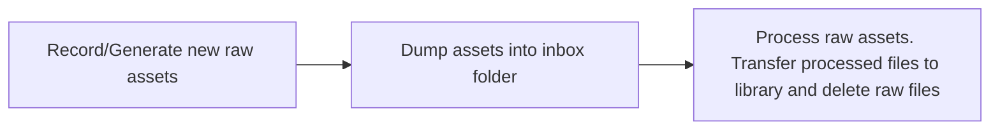

## Introduction

The least glamorous part of being a computer artist is dealing with your files.
This tutorial explains how to think about file management and explains
some strategies for keeping your files organized and safe.

## Goals

Let's start by establishing what we need to be able to do with our files:

- Work on active projects
- Share projects with collaborators
- Resume work on or clone old projects
- Build a portfolio
- Access reusable assets (e.g. your library of sounds)
- Develop a differentiated artistic identity by creating and curating a library
  of assets

And also bad things we want to avoid

- Losing files (e.g. corrupted hard drive)
- Being unable to find files
- Filling up storage on your computer

## File categories

We can generally group our files into three categories:

| Type           | Description                                                                   | Location                                                                 |
| -------------- | ----------------------------------------------------------------------------- | ------------------------------------------------------------------------ |
| Library Files  | Files relating to projects that you aren't currently working on               | On your computer or an external SSD (depending on size) (and backed up!) |
| Working Files  | Files that are part of projects that you are currently or recently working on | On your computer (or an external SSD for large projects) (and backed up) |
| Archived Files | Files relating to projects that you aren't currently working on               | On an external HDD or NAS (and backed up)                                |

### Library Files

Library files are files that don't necessarily belong to any particular
project. Examples include:

- Images, video clips, or sound clips that you want to be able to reuse
- Presets, plugins, templates, scripts, and other technical components that you
  use inside creative software

As a digital artist, your library is your set of materials. Your library
contains assets that **you** gather and curate. The library is a component of
the complex that distinguishes your work from everyone else's.

How you organize your library is up to you. What's important is that the
library provides for you **while you are making work**, in two ways:

1. Retrievability. You are able to find a specific thing that you're looking
   for.
2. Explorability. You are able to quickly explore the contents of the library,
   even if you don't know what you're looking for.

Luckily, retrievability and explorability go hand-in-hand. If you have a
well-organized library, you'll benefit in both ways. The point, really, is that
you are not having to root around in files and be annoyed at the same time that
you are trying to be productively creative (or creatively productive). The
(tedious) work of organizing the library happens **separately**.

#### Library organization strategy

As mentioned, this is up to you, but here are some ideas:

- You could organize chronologically, like with the project files. This is
  helpful if you know that you are likely to remember when you created a given
  thing, so that when you are working you can return to it quickly. It is also
  easy - you just make folders using the same big-endian format described above
  and plop your assets into those folders. The downside is that this scheme does
  not organize the assets thematically in any way.
- You could organize thematically. This requires you to come up with some sort
  of scheme. In our class, we used the [Universal Category
  System](https://universalcategorysystem.com/) (UCS), which is a set of
  categories for found and foley sounds. UCS uses a two-level categorization,
  where each sound has a major category (e.g. `water`) and minor category (e.g.
  `turbulent`). UCS recommends that you prefix your file names with a symbol that
  indicates the categories (e.g. `WATRTurb_`). If you want, you can also use a
  two-level folder system that maps to the categories (see below)

**Example library file structure with UCS**
























Libraries take work to build and maintain. Commonly you'll have large amounts
of raw material (such as the raw recordings from the field recorder) that need
to be processed (edited, classified, named and filed away). Therefore, it is a
good idea to have an "inbox" in your library where you can dump unprocessed
files. Later, you process these files, move them into the main library, then
delete or archive the raw files.

#### Processing library files

### Working Files

Working Files are files that are part of an active project that you're working on. The exact way these files are organized depends on the project and what software or technologies you're using, but, almost always, you'll have a folder for each project.

Your working files will usually live on your computer or on an SSD (for big projects).

Here's a project folder for Ableton Live:



-- top level folder for the entire project --



-- Ableton project folder --



-- .als (Live Set) files --





-- Project resources --










-- Exports and renders --












As you can see, we have a top level folder for the entire project. In this project, the only software we're using is Ableton, so we have an Ableton project folder, and then we have a folder for exports.

> [!TIP] What's "big-endian"?
> This means recording the date from the **most-significant** unit (_year_, in this case), to the least significant (_day_), in this case. The reason that we record dates this way is so that they are sorted in chronological order when looking at them in the file browser.

If you were working on a bigger project that used an additional piece of software, your structure might look like:




















... touch designer project goes here





#### Organizing Project Folders

It's a good idea to organize your project files by date. Usually, the way to do this is to use folders for each month in big-endian format:




















### Archived Files

Archived files look a lot like working files, but they're on a drive for
long-term storage rather than on your main computer. At its simplest, archiving
means plugging in the external hard drive that you use for archiving, and
moving project files from your main computer to the archive drive. Often,
you'll do this by moving over the folder for the whole month.

There are a few things to remember to do before you archive:

#### Consolidating a project

Your projects might often use shared files that reside outside of the project
(i.e. from your library). While you're actively working on the project, this
might be fine, but sometimes it is useful to localize the project's files to
the project folder. These scenarios include:

- Archiving. You're going to put the project into an archive and want to make
  sure everything it needs is included
- Sharing. You are sending the project to a collaborator for them to work on.
- Portability. If your library isn't on your computer, it might just be easier
  to copy library files into the project.

Most applications have a function that allows you to consolidate a project. In
Ableton Live, this is called "Collect All and Save". Learn what it is for your
favorite application and get used to using it.

## Storage media

Having established the three basic categories of files, let's think about where exactly
we can store them. There are five basic types of storage media:

| Type                           | Description                                                       | Purpose                                                                     | Connection Type           | Accessiblity | Storage Volume |
| ------------------------------ | ----------------------------------------------------------------- | --------------------------------------------------------------------------- | ------------------------- | ------------ | -------------- |
| On your computer               | In your computer's internal SSD / HHD                             | Active working files, frequently-used and lightweight library files         | Integrated                | High         | Low            |
| Portable SSD/HDD               | A portable drive (1 - 4 TB) that you can carry with you           | Extension of your computer's own storage. Larger projects and library files | USB                       | Medium       | Medium         |
| Desktop HDD                    | Big hard drive (> 4 TB) that is not portable                      | Archived project files, libraries, backup.                                  | USB                       | Low          | High           |
| Network-attached storage (NAS) | Specialized computer that accepts multiple removable hard drives. | Archived project files, libraries, backup.                                  | Network (LAN or internet) | Medium       | Very High      |
| Cloud storage                  | Dropbox, Backblaze, Google Drive, etc.                            | Sharing server for project files, backup for critical archive files         | Network                   | Medium       | Medium         |

There are a number of ways that you can use these types of storage media in your setup. By way of example, here's what mine looks like:

- **Macbook Pro**: Projects I am currently working on
- **1TB SSD:** My sample library and video projects (I always record video to
  the SSD to keep them off my computer)
- **Synology NAS:** My archive and older library files. Backup of laptop and
  external SSD
- **Dropbox**: No storage here, just a place to share easily with collaborators
- **Backblaze:** Backup of important files (final exports/renders of projects)
  archived on NAS

## Backups

You've heard it before: you should back up as much as possible. It's annoying,
but important! Here is how I recommend thinking about backup:

- Back up your computer and other working media (i.e. external SSDs) as much as
  possible. For many people, this means periodically backing up to a desktop hard
  drive at home using Time Machine,
  [Veeam](https://www.veeam.com/products/free/microsoft-windows), or some other
  backup tool.
- Back up your library.
- Back up critical parts of your archive. As your archive grows, it may be
  impractical or expensive to back up everything. Therefore, decide what you
  truly need backed up. For example, you may back up your archived projects for
  the past two years, and then after two years, only back up the final
  exports/renders and discard the other project files to save space.

### How to back up

There are a lot of ways to think about this, but the guiding principle is: try
to have things in more than one place. The more important something is, the
more secure it should be.

#### Backing up computer and working media

This is usually pretty easy. Find a backup utility that you like (e.g. Time
Machine on Mac). Get a desktop drive that is big enough to back up your
computer and your external SSD(s). Set all of them up to be backed up onto the
drive. Once a week, plug the drive into the computer and let the backup run.

The only downside is that you need to remember to plugin the computer into the
drive. If you have a workstation at home that you normally use, then this might
be easy, if you don't, then you need to be diligent.

If you have a NAS, you can schedule a backup routine to run on the NAS
automatically over the network. When I am home and my computer is connected to
the WiFi, it automatically backs itself up without my having to do anything. I
can also plug my external SSDs directly into the NAS with a USB cable, and it
automatically detects them and runs a backup routine.

## Backing up archive

Backing up your archive can be a bit more complicated. The basic
principle is that you have some second storage location (perhaps just a
separate hard drive) that your archive is backed up to. If your archive isn't
very big, maybe you just have two copies of it on two separate drives. When you
do your archiving routine every few months, you just copy everything to both
drives. If your archive is big, then maybe you don't want to backup the entire
thing, because this can get complicated and expensive. In this case, you might
reserve a particular set of files (important ones, such as renders and exports)
that you back up.

Managing an archive backup or a backup of a backup might required some special
software. One I've not tried but I see recommended is [Carbon Copy Cloner
](https://bombich.com/) for Mac. However, if your situation is complex enough
that you need to manage backups in sophisticated ways, you probably want a NAS.
The NAS is basically a computer whose main purpose is storage and backups, so
they come with utilities that allow the NAS to simultaneously act as a backup
for other devices (such as your computer) _and be backed up themselves_ to an
external hard drive, another NAS, or a cloud service.

## Version Control

Version control is worth mentioning here, but not at length. Version control is
the idea that for some working project, you are able to track the changes that
occurred to the project over time and return to a prior state of the project.
It could even mean having multiple versions of your project simultaneously
(e.g. one person is working on the visuals while somebody else works separately
on the sound), then merging the two versions.

Version control is pretty well figured out in the software world thanks to
[git](https://git-scm.com/). Git is truly amazing; it allows you to have a
detailed version history for your project, similar to the version history in a
Google Doc. It allows you to have multiple versions (called "branches") of your
project in parallel, which allows you to do things like pursue crazy
experiments that might not work without messing up your project. It also helps
with sharing and collaboration by making it easy to copy an entire project from
one computer to another.

You could definitely use git for lots of your projects. I personally use it for
all of my Max/MSP work. Honestly I should probably use it for Ableton projects,
too! However, it bears noting that git is designed for projects that are based
around text (i.e. code). A lot of project files are still text (often a JSON or
XML file), but some are compressed or in a binary format that won't always play
well with git.

I won't spend any more time on Git, but if you want to learn more about it (you
should, it's amazing), here are some resources:

- Daniel Schiffman (Coding Train) Tutorials:
  <https://www.youtube.com/playlist?list=PLRqwX-V7Uu6ZF9C0YMKuns9sLDzK6zoiV>
- Ry's Git Tutorial: <https://github.com/syn-bit/ry-s-git-tutorial>
