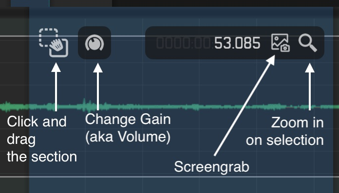

Download free: [https://www.ocenaudio.com/](https://www.ocenaudio.com/)
Video: [https://www.youtube.com/watch?v=6yVo19APRSw](https://www.youtube.com/watch?v=6yVo19APRSw)

## Viewing Mode

- `CMD + 1 show waveform`
- `CMD + 2 show spectogram only`
- `CMD + 3` waveform and spectrogram

## Zooming

Scroll to zoom

- Hold Q to “quick zoom” temporarily to cursor (e.g. great for fine-tuning the start and end points of a selection)
  - Release Q to zoom back out
- `CMD + plus/minus` to zoom in and out by steps
- `CMD + . (period)` to zoom back to previous zoom level
- `CMD + 0` to zoom out to full file

## Navigation and Selection

- Left/right arrows to jump in 1 second increments
- `CMD + left/right` arrows to jump in 10 second increments
- `CMD + OPT + left/right` to jump between [markers](https://app.notion.com/p/Ocenaudio-Cheat-Sheet-176ef84257e880288d77f5c0e312674b?pvs=21)
- `Shift + left/right` to select
- Home and end keys to jump to beginning and end of the file
- Click and drag to make a selection
- Hold `CMD` while clicking and dragging to make multiple selections
- `Shift + CMD` + I Invert selection

While selected:

- Starting the transport will only play the selected section(s)
- A hovering control pane will allow you to change the volume, zoom to the selection, and more
- Effects can be applied to the selected sections using the Effect menu

## Effects

This menu contains audio effects that will transform the audio. Effects that you might want to use are:

- Amplitude > Normalize... : Ocen Audio will automatically turn the volume up so that the loudest peak in the audio is at some threshold (e.g. 0dB)

## Markers and Regions

- `CMD + K` to add a marker or region (region if selected
- `Left / right` arrow keys + CMD + OPT to jump between [markers](https://app.notion.com/p/Ocenaudio-Cheat-Sheet-176ef84257e880288d77f5c0e312674b?pvs=21)

## Transport

- `Spacebar` to play
